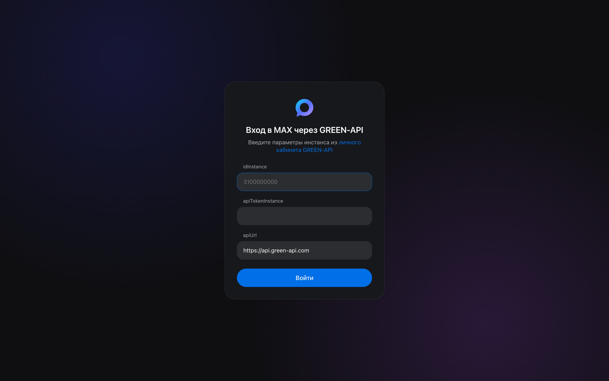
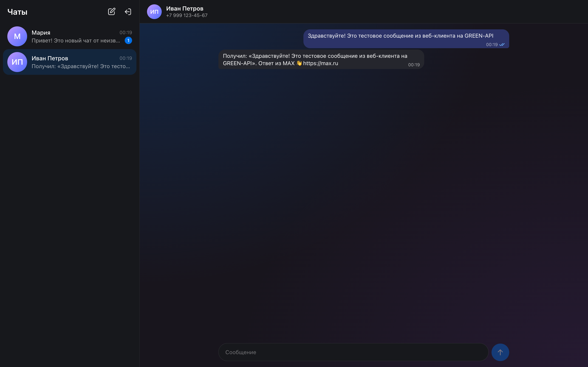
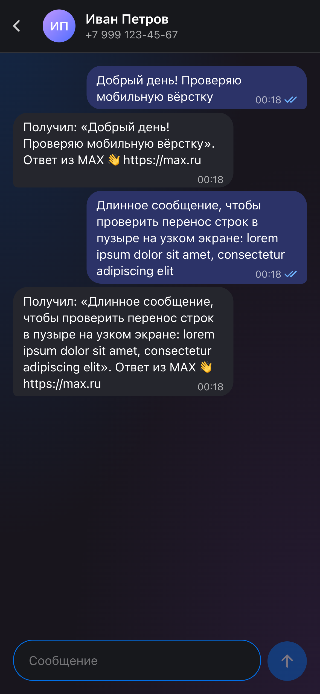

# MAX Chat · GREEN-API

Веб-клиент для отправки и получения текстовых сообщений в мессенджере [MAX](https://max.ru) через [GREEN-API](https://green-api.com/max). Внешний вид повторяет [web.max.ru](https://web.max.ru).

Тестовое задание на должность «Фронтенд разработчик React».

**Демо:** https://drewlosing.github.io/max-green-api-test-task/

| Вход | Чат | Мобильная версия |
| --- | --- | --- |
|  |  |  |

## Возможности

- Вход по `idInstance` и `apiTokenInstance` с проверкой состояния инстанса (`getStateInstance`).
- Создание чата по номеру телефона получателя.
- Отправка текстовых сообщений методом [`SendMessage`](https://green-api.com/v3/docs/api/sending/SendMessage/).
- Получение входящих сообщений по технологии [HTTP API](https://green-api.com/v3/docs/api/receiving/technology-http-api/): `ReceiveNotification` + `DeleteNotification`.
- Статусы исходящих: отправляется → отправлено → доставлено → прочитано, а также «не отправлено».
- Сообщения от новых собеседников создают чат автоматически, непрочитанные отмечаются счётчиком.
- Сообщения, отправленные с телефона, тоже появляются в чате.
- История и вход сохраняются между перезагрузками страницы.
- Адаптивная вёрстка: на узком экране показывается либо список чатов, либо открытый чат.

## Как проверить

1. Зарегистрируйтесь в [личном кабинете GREEN-API](https://console.green-api.com/) и создайте инстанс для MAX.
2. Авторизуйте инстанс: отсканируйте QR-код в приложении MAX на телефоне. Состояние инстанса должно стать `authorized`.
3. В настройках инстанса:
   - оставьте **пустым** `webhookUrl` — иначе уведомления уйдут на вебхук, а не в очередь HTTP API;
   - включите уведомления о входящих сообщениях (`incomingWebhook`);
   - для статусов и синхронизации с телефоном включите статусы отправленных сообщений (`outgoingWebhook`) и уведомления о сообщениях, отправленных через API и с телефона (`outgoingAPIMessageWebhook`, `outgoingMessageWebhook`).
4. Запустите приложение (см. ниже), введите `idInstance` и `apiTokenInstance` из кабинета. `apiUrl` менять не нужно, если в кабинете не указан другой.
5. Нажмите «Новый чат», введите номер получателя, у которого есть MAX, и отправьте сообщение.
6. Ответьте с телефона получателя — ответ появится в чате.

## Локальный запуск

Нужен Node.js 20.19+ или 22.12+.

```bash
npm install
npm run dev
```

Приложение откроется на http://localhost:5173.

| Команда | Что делает |
| --- | --- |
| `npm run dev` | Dev-сервер с hot reload |
| `npm run build` | Проверка типов и production-сборка в `dist/` |
| `npm run preview` | Локальный просмотр собранной версии |
| `npm test` | Unit-тесты (Vitest) |
| `npm run lint` | Линтер (oxlint) |
| `npm run typecheck` | Проверка типов TypeScript |

Сборка статическая и работает из любого подкаталога (`base: './'`), поэтому её можно выложить на GitHub Pages, Netlify или любой статический хостинг. Бэкенд не нужен: GREEN-API отвечает с заголовком `Access-Control-Allow-Origin: *`, и браузер обращается к API напрямую.

## Стек

React 19, TypeScript, Vite, CSS Modules, Vitest, oxlint. Других зависимостей нет.

## Устройство

```
src/
├── api/          клиент GREEN-API и типы ответов
├── chat/         разбор уведомлений и редьюсер состояния чатов (чистые функции, покрыты тестами)
├── hooks/        useNotificationPolling — цикл получения уведомлений
├── components/   интерфейс
└── lib/          телефоны, форматирование дат, localStorage
```

**Получение сообщений.** Цикл по одному забирает уведомление (`ReceiveNotification` с долгим ожиданием 20 с), применяет его и удаляет из очереди (`DeleteNotification`). Удаление после обработки даёт доставку «хотя бы один раз», а повторы отбрасываются по `idMessage`. Разбор уведомлений никогда не бросает исключений: иначе «битое» уведомление не удалилось бы и заблокировало очередь. При ошибках сети цикл повторяет запросы с экспоненциальной задержкой от 1 до 30 секунд и показывает плашку с ошибкой.

**Чат по номеру телефона.** Новый чат отправляет сообщения на `79991234567@c.us`. Настоящий `chatId` собеседника в MAX приложение узнаёт из уведомлений: из копии отправленного сообщения, из статуса доставки или из ответа (по номеру отправителя). После этого все сообщения этого собеседника попадают в один чат.

**Статусы** только повышаются (отправлено → доставлено → прочитано), поэтому уведомления, пришедшие не по порядку, не откатывают статус назад.

## Ограничения

- История хранится только в `localStorage` этого браузера: GREEN-API удаляет уведомления из очереди после получения, и повторно их не получить.
- `apiTokenInstance` хранится в `localStorage`. Для демо это допустимо; в продакшене запросы стоит проксировать через свой бэкенд.
- Очередь уведомлений у инстанса одна: если открыть приложение в двух вкладках, они поделят входящие сообщения между собой.
- Поддерживаются только текстовые сообщения. Остальные типы (фото, файлы, голосовые) пропускаются.
